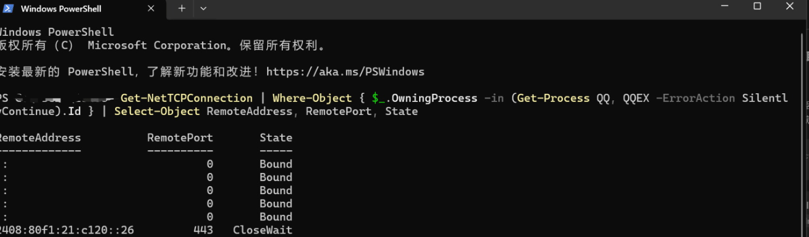
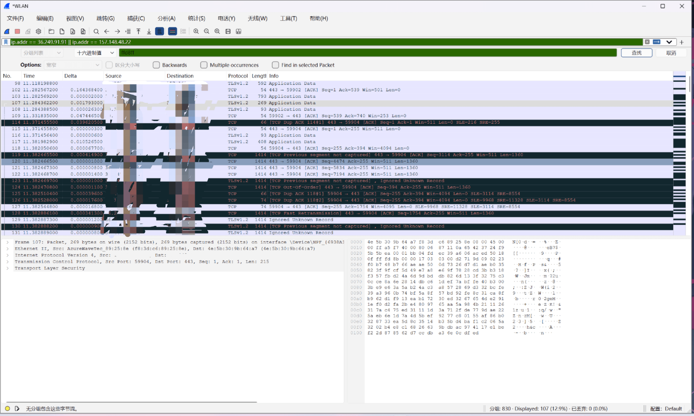
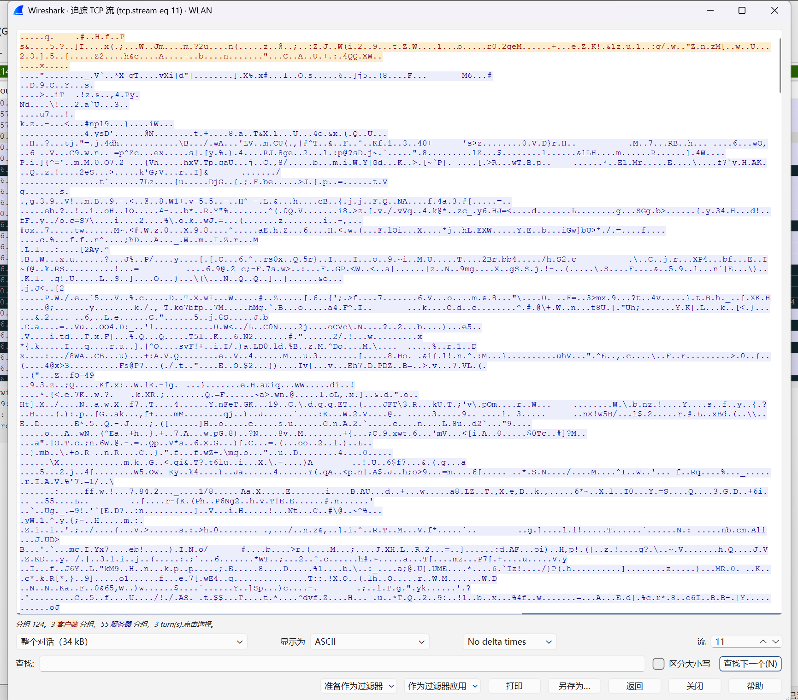
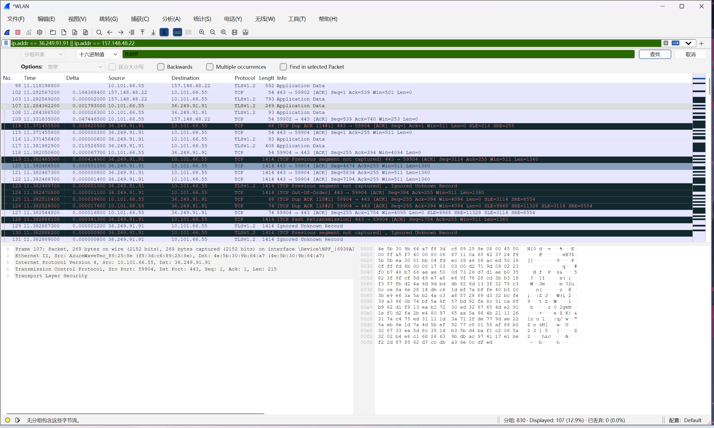

# 信息安全作业：QQ流量分析（PC-PC端、PC-手机端）

### 第一部分：实验原理与网络基础

#### 1. 网络通信基础参数
实现上网，通常需要网关（Gateway）、子网掩码、IP地址等核心参数。子网间的通信必须依赖路由器（网关）。如果没有路由器，各个子网将是孤立无法通信的。在Windows系统中，我们通常使用 `ipconfig /all` 查看网络配置，使用 `netstat -an` 查看当前网络连接状态。

#### 2. Wireshark 应用初步
Wireshark 是一款强大的网络协议分析工具。本实验将利用其以下核心功能：
- **捕获报文**：选择指定的网卡（如 WLAN）捕获流经该网卡的所有数据包。
- **筛选 IP 与协议**：利用过滤器（如 `ip.addr == x.x.x.x`）从海量背景流量中精准定位目标应用（QQ）的流量。
- **搜索与追踪**：通过正则表达式、字符串或十六进制特征码进行搜索，以及追踪完整的 TCP 流来查看应用层载荷，验证加密状态。

---

### 第二部分：实验操作与数据获取

#### 1. 确定 QQ 通信服务器 IP
现代网络应用（如 QQ）会与多个服务器建立连接。为了精准定位，我们以管理员身份打开 PowerShell，执行以下命令获取 QQ 进程的远程连接 IP：

```powershell
Get-NetTCPConnection | Where-Object { $_.OwningProcess -in (Get-Process QQ, QQEX -ErrorAction SilentlyContinue).Id } | Select-Object RemoteAddress, RemotePort, State
```

{ .glightbox }

**现象分析**：截图显示，QQ主要建立了基于 `443` 端口（HTTPS）的连接，状态多为 `Established`（已建立）。获取到的主要远程 IPv4 为 `36.249.91.91` 和 `157.148.48.22`（注：同时存在IPv6通信）。

#### 2. Wireshark 过滤与现象观察
在 Wireshark 中选择 `WLAN` 网卡开始抓包，在 QQ 中向好友或文件传输助手发送文字、图片和压缩包后，停止抓包。在顶部的显示过滤器中输入获取的 IP 进行精准过滤：

```text
ip.addr == 36.249.91.91 || ip.addr == 157.148.48.22
```

**现象与原理分析**：
在抓包列表中，Protocol（协议）列主要显示为 `TCP` 和 `TLSv1.2`。
*注：在抓包过程中，出现了许多红底或黑底的数据包，提示如 `[TCP Previous segment not captured]`（之前的报文段未捕获）或 `[TCP Out-Of-Order]`（TCP 乱序）。这是因为无线网络（WLAN）存在信号波动，抓包网卡漏掉了部分数据包导致的。但这不影响我们分析整体的协议架构和应用层加密状态。*

---

### 第三部分：核心问题分析

#### 1. QQ 通信使用的是 UDP 还是 TCP？
**答：使用的是 TCP 协议。**
**深度分析**：
从抓包列表的 Protocol 列直观可见，当前 QQ 流量绝大部分基于 `TCP`。结合端口信息，通信主要建立在 `443` 端口。老版本的 QQ（OICQ 协议）曾大量使用 UDP 协议（如 8000 端口）以提高传输速度，但新版 QQ（NTQQ）为了保证消息的可靠送达、文件传输的完整性，全面转向了基于 TCP 的传输架构。TCP 的面向连接、可靠传输特性，更符合现代即时通讯的需求。

#### 2. QQ 通信是加密还是明文？
**答：全程加密（基于 TLS 加密）。**
**深度分析**：
在 Wireshark 中选中任意 QQ 相关的 TCP 数据包，右键选择 **追踪 (Follow) -> TCP 流 (TCP Stream)**。
在追踪流弹出的窗口中，我们可以观察到两个关键现象：
1. 在协议识别上，Wireshark 将其识别为 `TLSv1.2` 甚至 `TLSv1.3` 的握手过程（如 Client Hello 阶段可见 `SNI=tpstelemetry.tencent...` 等腾讯域名）。
2. 在数据内容上，应用层数据（Application Data）全部呈现为红蓝相间的**乱码**。

这证明 QQ 采用了严格的 TLS 加密机制，通信内容（包括文字、图片、文件）在发送前已被加密算法处理，即使抓到了底层的包，没有密钥也无法查看任何明文内容。

{ .glightbox }
{ .glightbox }

#### 3. 恢复可能为明文传输的文件
**答：无法直接恢复明文文件。**
**深度分析**：
文件通常具有独特的头部特征码（Magic Number），例如 JPG 图片的文件头为十六进制 `FF D8 FF`，ZIP 压缩包为 `50 4B 03 04`。如果在未加密的 HTTP 或 FTP 传输中，我们可以通过搜索这些特征码定位文件流并提取。

我们在 Wireshark 中按下 `Ctrl + F` 调出“查找分组”窗口，将查找类型设置为 **“十六进制值”**，输入图片特征码 `ffd8ff` 进行查找。结果 Wireshark 底部状态栏提示 **“无分组包含这些字节流”**。

{ .glightbox }

**原理解释**：由于 QQ 文件传输同样被包裹在 TLS 加密通道内，原本文件头部的 `FF D8 FF` 在加密后变成了完全随机的字节。因此，在加密流量中直接搜索明文特征码是无效的，无法通过此方法抓取还原出文件。

---

### 第四部分：实验总结
通过本次实验，我不仅掌握了 Wireshark 的基础抓包、条件过滤、流追踪等操作，还学会了结合 PowerShell 提取应用底层网络连接信息的方法。更重要的是，通过实际抓包和分析，直观地验证了现代即时通讯软件的安全机制：全面采用 TCP 协议保障可靠性，并全程使用 TLS 协议加密数据。这有效防范了中间人攻击和流量嗅探，保护了用户的隐私安全。