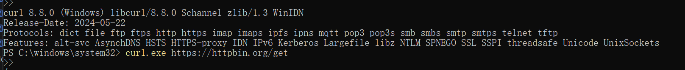
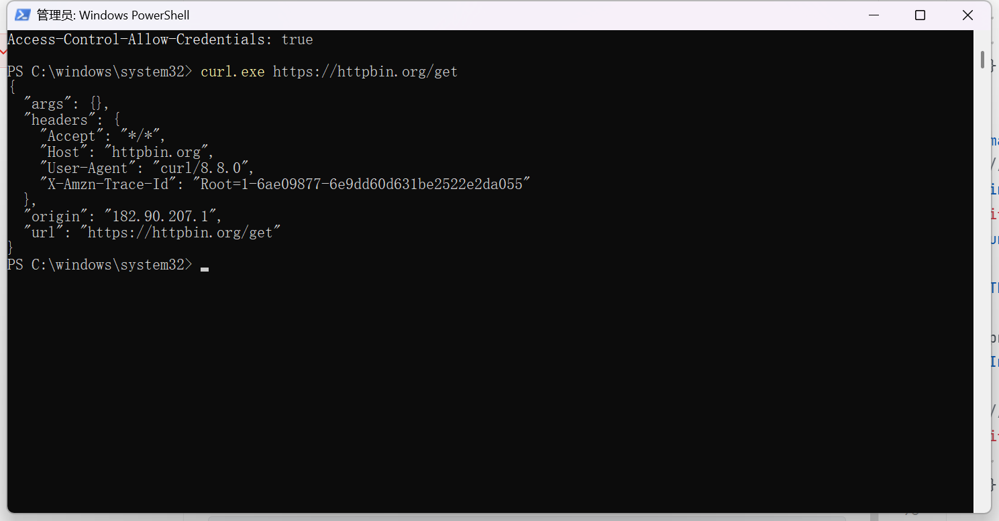
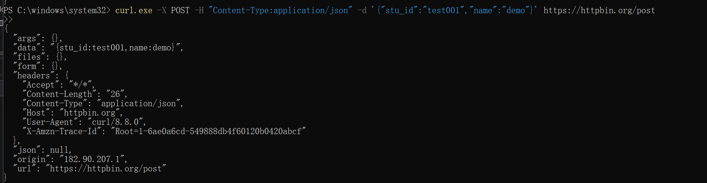
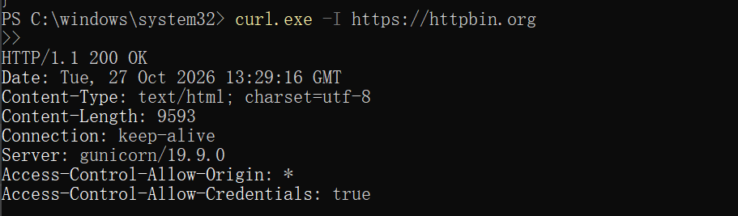

# 信息安全作业：curl工具主动扫描实验

## 第一部分：curl工具基础认识
### 1. 什么是curl？
curl（Client URL）是一款命令行的数据传输工具，支持HTTP、HTTPS、FTP、SFTP等二十多种协议。常用于API接口调试、网络请求测试、Web服务探测，是网络安全、后端开发中很常用的基础工具。
> 注意：PowerShell中直接输入curl是`Invoke-WebRequest`的别名，真实程序需要写`curl.exe`。

### 2. 实验安全说明
本实验仅使用公开免费测试站点 httpbin.org 进行请求测试，**不对任何未授权的服务器、网站进行探测**；测试数据全部使用虚构数据，不提交手机号、身份证、账号密码等隐私信息。公网IP会被目标服务器记录，截图发布博客时可按需打码origin对应的IP地址。

## 第二部分：实验环境与操作
### 1. 环境准备
- 操作系统：Windows
- 终端：PowerShell
- curl版本：curl 8.8.0（系统自带，无需额外安装）

### 2. 查看curl版本
```powershell
curl.exe --version
```
{ .glightbox }
- 发现window中自带curl，可使用进行测试
### 3. Get请求测试
```
curl.exe https://httpbin.org/get
```
- 运行如下图
{ .glightbox }


### 4. POST JSON 请求测试
- 请求如下
```
curl.exe -X POST -H "Content-Type:application/json" -d '{"stu_id":"test001","name":"demo"}' https://httpbin.org/post
```
{ .glightbox }


### 5. 仅获取响应头（主动探测常用）
```
curl.exe -I https://httpbin.org
```
- 响应如下
{ .glightbox }

 ## 第三部分：实验小结

- curl 不需要图形浏览器，在命令行就可以自由构造 HTTP 请求，灵活方便。在主动扫描场景下，可以用来探测 Web 服务返回包、验证接口连通性；同时要牢记网络安全红线：**所有探测行为必须获得目标授权，禁止私自扫描他人服务器**。