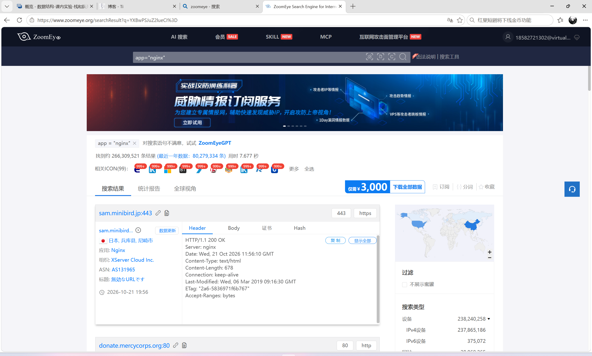
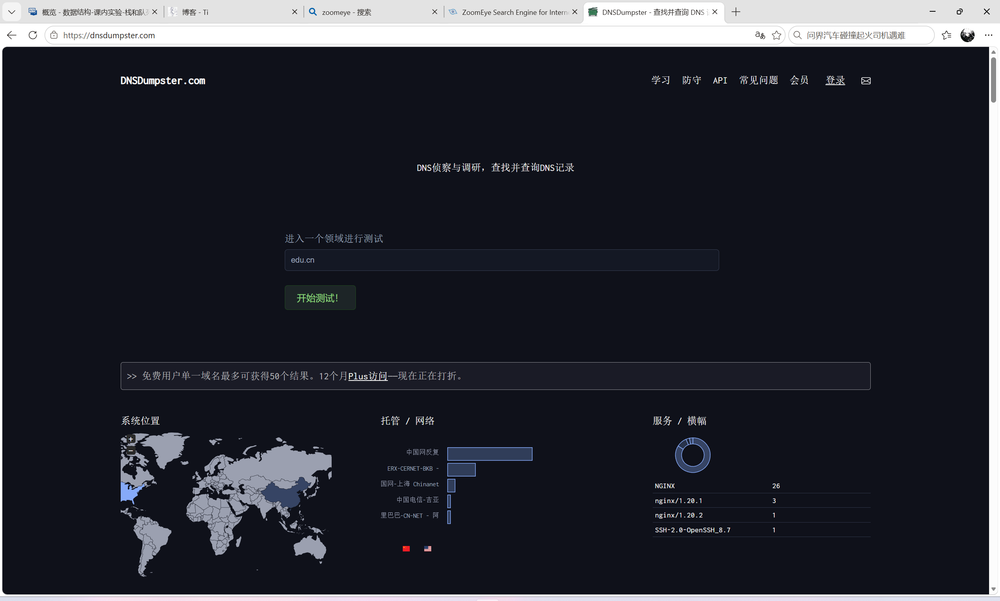
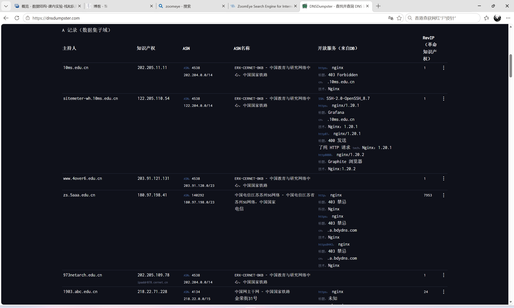

# 信息安全作业：被动扫描与子域名收集

### 第一部分：与 ZoomEye 功能类似的搜索引擎

ZoomEye 属于网络空间测绘引擎，它索引的不是普通的网页内容，而是互联网上暴露的 IP、端口、服务、协议 banner 和设备指纹。除了 ZoomEye，目前主流的同类平台还有：

- **FOFA**：国内常用，支持 HTML 源码级检索，语法灵活，国内资产覆盖较全。
- **360 Quake（鹰图）**：360 旗下资产测绘平台，数据更新快，语法与 ZoomEye 较为接近。
- **Shodan**：最早的 IoT 与设备搜索引擎，海外设备指纹和 banner 数据较强。
- **Censys**：学术背景，在 TLS 证书与主机测绘方面较突出，适合从证书维度发现资产。
- **奇安信 Hunter**：国内资产覆盖率较高，适合国内政企与高校资产测绘。

---

### 第二部分：ZoomEye 搜索实操

在公共搜索平台[Zoomeye](https://www.zoomeye.org/`) 登录后，输入检索语句进行资产搜索。本次实验使用基础语法进行测试。

**检索语法**：`app="nginx"` （检索使用 Nginx 服务的资产）

> *说明：在 ZoomEye 公共搜索页查询 `app="nginx"` 结果截图。*

---

### 第三部分：子域名收集实操

**平台选择**：[DNSDumpster](https://dnsdumpster.com/) 是一款免费的被动 DNS 信息收集工具，能够从攻击者视角发现与目标域名关联的主机、子域名及网络拓扑。

**实操过程**：
输入公共教育域名 `edu.cn` 进行检索。从结果可以看出，该平台成功抓取并聚合了大量数据：
1. **资产规模**：共发现 `148,136` 条记录（免费版展示前 50 条）。
2. **系统分布**：通过世界地图直观展示了服务器的地理分布位置。
3. **托管网络与服务**：识别出主要的托管网络为 `CHINANET-BACKBONE`，并探测到了 `nginx` 和 `SSH` 等服务的 Banner 信息。

> *说明： DNSDumpster 包含世界地图、网络分布和底部红字提示的截图。*

**子域名列表提取**：
向下滚动页面，在 `A Records (subdomains from dataset)` 区域可以查看具体的子域名记录列表，这为后续的资产梳理和漏洞评估提供了重要的目标清单。

---

### 第四部分：合规声明

本次实验仅针对 `edu.cn` 等公开测试或公共服务域名进行被动查询，未对任何目标进行主动扫描、漏洞利用或破坏性探测。所有操作均在合法合规的前提下进行，旨在学习网络安全信息收集的基本原理，遵守《网络安全法》及相关伦理规范。
